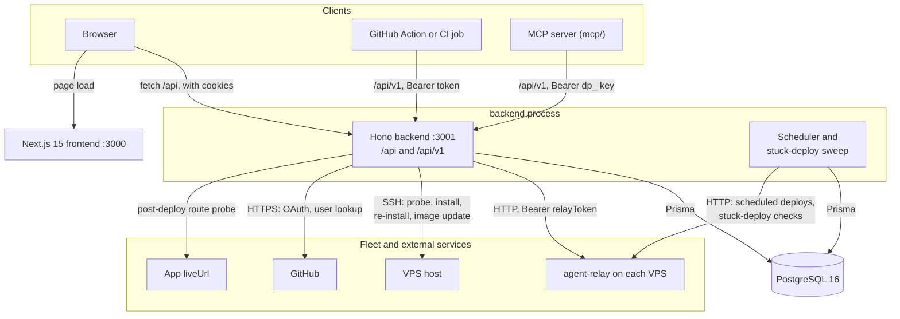
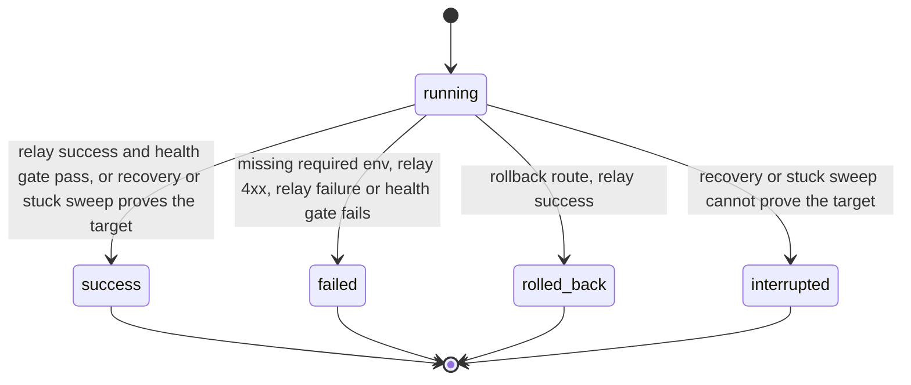

# Architecture

How deploy-panel turns a fleet of VPS boxes into a single web UI plus a CI-friendly REST API.

## Layers

The diagram shows the network edges of a running panel: the clients that call the backend, the stores and hosts the backend talks to, and the scheduler that runs inside the backend process.

The frontend serves pages and client-side code; the browser calls the backend's REST API directly, so the backend must be reachable from the browser (same origin under `/api` in `docker-compose.prod.yml`). The backend owns all persistence (Prisma + PostgreSQL) and is the only component that talks to relays (HTTP) and to VPS hosts (SSH, for relay onboarding and maintenance). There is no direct browser-to-relay path: every relay call is proxied through the backend so the panel can record audit entries, attach the right `relayToken`, and update deploy status in one place.

## Stack

| Layer    | Stack                                   |
|----------|-----------------------------------------|
| Frontend | Next.js 15, React 19                    |
| Backend  | Hono, Prisma, Zod, Node.js 20+          |
| Database | PostgreSQL 16                            |
| Relay    | HTTP client proxying to agent-relay APIs |
| Provisioning | SSH client (relay probe, install, re-install, image update) |

## Relay integration

Each `Server` row stores a `relayUrl` (e.g. `http://vps-ip:3002`) and an optional `relayToken` for Bearer authentication. When the panel triggers a deploy, rollback, log fetch, or preflight check, the backend:

1. Looks up the server's relay credentials from the database.
2. Forwards the request to the agent-relay HTTP API (e.g. `POST /api/apps/:name/deploy`, `POST /api/apps/:name/rollback`, `GET /api/apps/:name/logs`, `GET /api/apps/:name/preflight`).
3. Records the result in the `deploys` table and updates the app status.

The backend also calls the relay for env reads and writes, app listing and detail (sync and the upstream check), and the relay `/health` version check.

Relay calls use per-operation timeouts: 5 seconds for connectivity and system-info checks, 5 minutes for standard relay operations (rollback, logs, preflight), and 10 minutes for streaming deploys. A relay 4xx or a relay-reported failure marks the deploy failed. When the connection is lost or the relay answers 5xx, connection-loss recovery marks the deploy success only when the post-deploy health gate confirms the app and the relay history shows this deploy reached its target, interrupted when the app is healthy but that proof is missing, and failed otherwise; see `docs/okf/deploy-outcome-trust-chain.md` for the full mechanism. The outcome is visible in deploy history either way.

## Data model

- **Server**: a VPS instance with host, optional SSH key path, relay URL/token, and connection status (`unknown`, `online`, `offline`, `no-relay`).
- **App**: a deployed application per server with health status (`unknown`, `healthy`, `unhealthy`, `deploying`); unique per `(serverId, name)`. Apps enter the panel through relay sync (only apps the relay reports as configured; the server page syncs on every load) or on the first panel action that names the app: a UI deploy, bulk deploy or rollback, an env, secret or required-env edit, or a scheduled deploy. `/api/v1` never creates apps and answers 404 for an app the panel does not know yet.
- **Deploy**: deployment history with commit SHAs (before / after), status (`running`, `success`, `failed`, `rolled_back`, `interrupted`), duration, logs, and trigger source. Every writer creates a row as `running`; `pending` is only the column default and is never written.
- **Audit**: append-only audit trail of user-initiated actions (deploy, rollback, server changes, etc.).
- **ScheduledDeploy**: a one-time deploy queued for a future `scheduledFor` time (`pending`, then `triggered` or `cancelled`); the backend checks for due entries every 60 seconds.
- **User**: a GitHub identity, created by the native OAuth login or the identity broker. A user acts as a non-admin actor.
- **Session**: hashed GitHub login sessions.
- **ApiKey**: hashed `dp_` keys. A key bound to a user acts as that user (the identity broker issues these); a key without a user binding acts as admin.
- **AppSecret**: per-app secrets encrypted with `APP_SECRETS_KEY`.
- **EnvVarChange**: history of env keys edited through the panel (no values).

`Server.userId` is null for admin-shared servers and set for servers a non-admin user created; see [okf/auth-and-ownership-model.md](okf/auth-and-ownership-model.md).

The state diagram shows how a deploy row moves from `running` to its final status and which code path decides each one.

## Frontend pages

| Route              | Page             | Description                                                                 |
|--------------------|------------------|-----------------------------------------------------------------------------|
| `/`                | Dashboard        | Overview with server count, app count, online status, and recent deploys     |
| `/servers`         | Server List      | Add / remove servers, test relay connections, view status badges             |
| `/servers/[id]`    | App Management   | View apps on a server; deploy, rollback, view logs, run preflight checks     |
| `/deploys`         | Deploy History   | Filterable table of all deployments with status, commit, duration, timestamp |
| `/audit`           | Audit Log        | Filterable audit trail of user actions                                       |
| `/scheduled`       | Scheduled Deploys| Fleet-wide list of upcoming one-time scheduled deploys; reschedule one (opens the schedule dialog to pick a new time; the old entry stays until cancelled from the dialog's pending list) or cancel a pending one |
| `/login`           | Login            | Authentication page                                                          |
| `/settings`        | Settings         | Create, list and revoke `dp_` API keys; shows example API and MCP invocations |
| `/styleguide`      | Styleguide       | Design-token and component reference; an unlinked dev route (not in the navigation), dark-only palette; not gated: it is a static page served in production builds too, and needs no login |

## Why proxy instead of direct browser-to-relay?

Three reasons. First, `relayToken` should never reach the browser: keeping it server-side means a compromised browser session cannot exfiltrate fleet credentials. Second, deploy status and audit logging belong on the backend (next to the database), so a single code path records every deploy regardless of trigger (UI, CI, schedule). Third, CORS and TLS termination are simpler when the relay is only ever called from one well-known origin.
